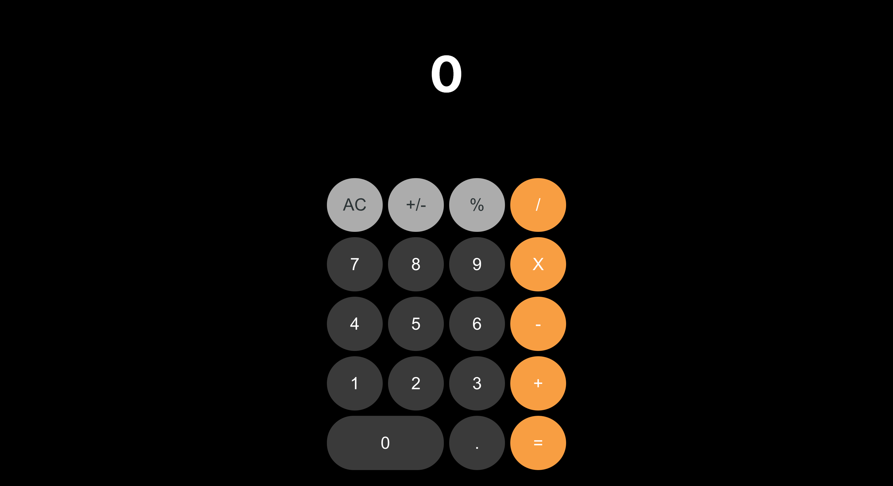

# iOS Calculator

A calculator that looks and behaves like the one on an iPhone, running in the browser. It was built as a React exercise: recreate a given design and make the buttons work.



## What it does

- Digits 0 to 9 and a decimal point, up to 8 digits at a time
- Add, subtract, multiply (`X`), divide and percent (modulo)
- Toggle between positive and negative with `+/-`
- Clear everything with `AC`
- Equals button that shows the result of the pending operation
- Results are rounded to a few decimal places

The original version was hosted on Heroku at https://calculatorcapital.herokuapp.com/ . That link may no longer be online, so the steps below show how to run it yourself.

## Tech stack

- React 16 (function components, hooks and the Context API for state)
- Create React App (`react-scripts` 2.1.8)
- styled-components and plain CSS
- ESLint and Prettier configuration packages

## Run it

You need Node.js and npm. A fairly old Node version (around 10 to 14) works best with this version of `react-scripts`. On newer Node versions, if `npm start` or `npm run build` fails with an OpenSSL error, run it with `NODE_OPTIONS=--openssl-legacy-provider`.

```bash
npm install
npm start
```

Then open http://localhost:3000.

## Build a static demo

```bash
npm run build
```

This creates a `build/` folder of plain static files. No secrets or server are needed. Serve that folder with any static host, or locally with:

```bash
npx serve build
```

The `homepage` setting in `package.json` is `.`, so the build also works when hosted under a sub path.

## Status

Working. It is a small finished exercise, not under active development. The percent button computes a remainder, and chained operations are simpler than on a real iPhone.

## Credits

The visual design is based on the iOS calculator design provided as the exercise brief. Code by Max Awad.
